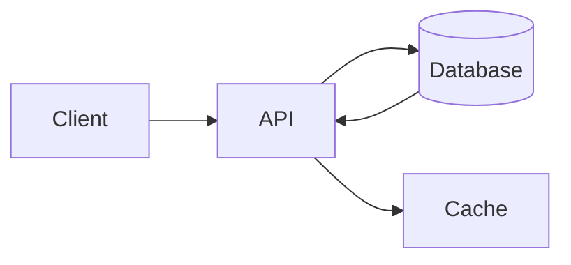

# Build and share a diagram

In this tutorial you will render a diagram, change it, restyle it for a dark page and hand it to someone else as a single file that still knows how it was made.

## Render something

1. Open the [diagram renderer](https://jorisvddonk.github.io/web-tools/diagrams.html).
2. The **Format** selector is already on *Mermaid* and the **Example** selector on *Architecture flowchart*.
3. The preview on the right shows a small architecture: Client → API → Database and Cache.

The source on the left is plain text:



## Change it

1. Click at the end of the source and add a line:

   ```mermaid
   API --> Queue[Queue]
   ```

2. The preview re-renders as you type, because **Live** is ticked. Untick it if you prefer to press **Render** yourself.
3. Add `Queue --> Worker[Worker]` too. The layout adjusts automatically.

## Restyle it

1. Press the **Dark mode** button in the toolbar.
2. The page, the editor and the diagram all switch palette together.
3. Press it again to go back to light. The choice is remembered next time you visit.

## Export it

1. Press **SVG** above the preview. A file called `mermaid.svg` is downloaded.
2. Open that file in a browser or an editor. It is a normal SVG, and it also contains the Mermaid source you typed, in a `<metadata>` element.

PNG export works the same way, except for Markmap and BPMN: those two use structures that browsers cannot reliably rasterise, so the PNG button is disabled and the SVG export is the supported path.

## Get it back

1. Press **Clear** to empty the editor.
2. Drag the downloaded `mermaid.svg` onto the page.
3. The format switches back to Mermaid and your source is restored exactly as it was, including the `Queue` and `Worker` nodes.

That round trip is the point of the metadata: an exported image is also a saved diagram.

## Where to go next

- [Render a diagram](../how-to/render-a-diagram.md) for choosing a format deliberately.
- [Share and restore diagrams](../how-to/share-and-restore-diagrams.md) for the full import/export rules.
- [Diagram formats](../reference/diagram-formats.md) for every renderer and its syntax reference.
